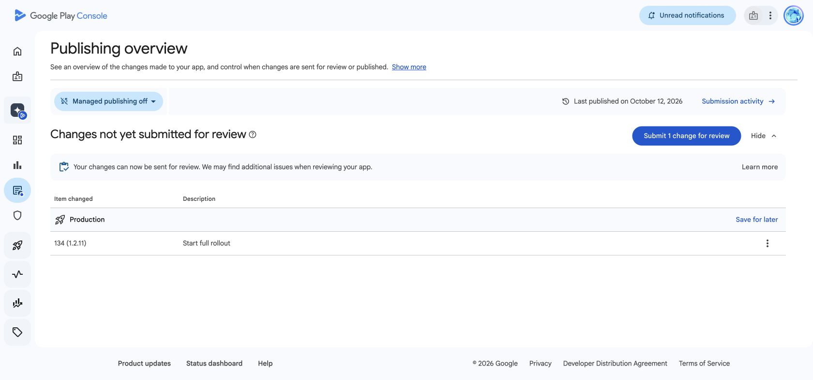

# Sanctuary 1.2.11 — Daily Discoveries

Release branch: release/daily-discoveries-1.2.11. Application commit: d58e87af61006abc014e961f6a46fa6d6d235e49.

## Store copy to use when the feature is activated

A little curiosity, every day. Discoveries brings daily Bible trivia to Sanctuary, with a quick timed question, a fresh detail, and Scripture in your preferred Bible translation. See your response time, build a streak of correct days, and share a simple result without giving away the answer. Optional evening reminders are available in your profile.

Do not publish this copy while Discovery is disabled on the production backend.

## Signed packages and upload

- iOS: EAS build 4ac1ed3f-4a3d-4ce9-aa3c-12361c5a1082, version 1.2.11 (63), finished. New distribution certificate/profile renewed for the existing bundle/team, valid through October 28, 2027. Push key and App Store Connect API key preserved.
- iOS upload: submission be600d49-0c7c-4a92-b650-ffcdbe912725 succeeded. Apple processing/TestFlight availability is separate from App Review and public release. No App Review request or public release was made here.
- Android: EAS build 2b135c3e-8bce-485d-8fa6-9577b96442ba, version 1.2.11 (134). Finished and uploaded successfully to the internal test track (submission b00d811c-087d-4e90-8483-8fc073e13add). The production submit profile publishes to the production track; do not invoke it until launch gates pass. Use the configured internal profile for an internal test release.

## Acceptance

Automated typecheck, 14 Discovery tests and existing mobile behavior checks pass. Prior simulator design checks are recorded under docs/design/2026-10-28. Only the existing Sanctuary QC simulator is used.

Physical-device acceptance still includes large text and screen readers; terminated-app notification routing; share-sheet cancellation; account switching and offline/reconnect; generic/direct universal links with and without an installed app; preferred translation and the internal Bible reader. Never send a live test push to real users without selecting the intended opted-in test account.

Production recovery, Small compute and all six database migrations are installed. Public activation remains gated by sufficient approved content and device acceptance. Discovery's Home card stays hidden while the server flag is off. New reminder preferences default off, and older native tokens cannot receive trivia pushes unless they register the new capability.

Related PRs: mobile #3, backend #17, layperson web #3, marketing #2. The backend rollout record contains exact service/deployment IDs and migration hashes.

## Store drafts — October 29 checkpoint

App Store Connect metadata for 1.2.11 synced successfully, including six existing screenshots and the release notes above. The metadata tool downloaded PNGs with .jpg suffixes; matching .png filenames resolved the upload failure without changing screenshot bytes. Existing age-rating answers were preserved. Build 63 was selected, manual release was selected, and Save acknowledged the draft. The browser session subsequently expired. App Review was not requested. Private reviewer contact details remain in the isolated temporary store configuration, outside Git.

Google Play production release draft 16 contains bundle 134 only, with 133 excluded and the release notes saved. Preliminary checks completed successfully. The only bundle warning concerns an optional deobfuscation file. Publishing overview shows one change ready to send for review; it has not been submitted or released. Managed publishing remains in its existing off state, so do not send this change until the public launch gates pass.

At 12:07 UTC the production schedule contains nine questions total, eight today/future and only two consecutive days through October 30. Public Discovery and reminders remain disabled, with zero trivia deliveries. The authenticated reminder dry run passed without sending. Both websites remain staged. See the backend rollout record for exact infrastructure IDs, proof and remaining gates.
